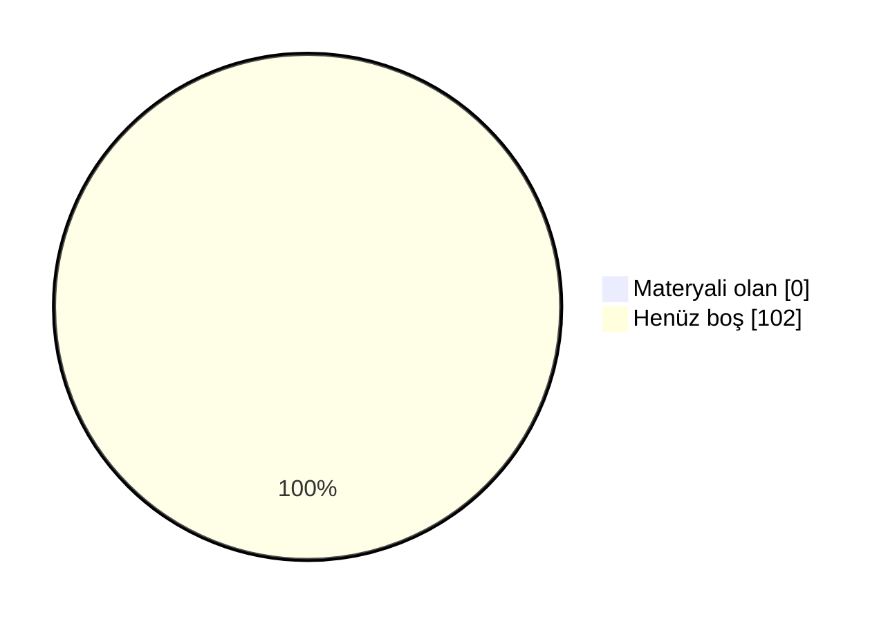

# 📖 Marmara Siber Güvenlik Mühendisliği Arşiv

Marmara Üniversitesi Teknoloji Fakültesi Siber Güvenlik Mühendisliği öğrencileri için düzenli, sürdürülebilir ve değer üreten bir akademik arşiv. Ders notları, ödev çözümleri, slaytlar, çıkmış sorular ve çalışma rehberleri tek bir yerde toplandı.

 ## 🗣️ Geri Bildirimde Bulunun

📬 Öğrenciler ve hocalar, derslerle ilgili hakaret içermeyen geri bildirimlerinizi aşağıdaki linkler aracılığıyla anonim olarak paylaşabilirsiniz.

- ℹ️ Geri bildirim formları yakında eklenecek.

## 🤝 Katkıda Bulunun

Elinde ders notu, slayt, çıkmış soru ya da ödev çözümü varsa arşive eklemek çok kolay:

- 📁 **GitHub kullanmıyorsan:** [Google Drive klasörümüze](https://drive.google.com/drive/folders/1KRobMRVHpJxUKcCZdCEippSZ5SmgpkZq?usp=sharing) yükle. Önce BENİOKU dosyasını oku, sonra **Siber-Teknoloji** klasöründe kendi adınla bir klasör aç.
- 🌐 **GitHub hesabın varsa:** Repoyu fork'la, dosyayı ilgili ders klasörüne yükle ve pull request gönder. Kurulum gerekmez, her şey tarayıcıdan yapılır.
- 📖 **Adım adım rehber:** [CONTRIBUTING.md](CONTRIBUTING.md)

Pull request ile katkıda bulunanların adı sayfanın en altındaki **Katkıda Bulunanlar** listesine otomatik eklenir.

### 📺 Video Rehberler
- 🎬 **Repoya nasıl katkı yapılır?** (~10 dk): *yakında*
- 🎬 **Repo nasıl kullanılır?** Klasör yapısı, ders README'leri ve aradığını bulma: *yakında*

<b>🛠 Repo Kullanımı</b>

## 🛠 Repo Kullanımı

### ⚙️ Açıklamalar:
- 📋 Bölümde bilinen ve güvenilir bir kaynak olmak.
- 📋 Akademik network oluşturmak ve iş birliklerini kolaylaştırmak.
- 📋 Dışarıdan bakan biri için temiz, düzenli ve profesyonel bir imaj sunmak.
- 📋 İçerikler: ders slaytları, kişisel ders notları ve özetler, ödev çözümleri, atölye çalışmaları, çıkmış sorular ve analizleri, proje dosyaları ve örnekleri.

### 📝 Talimatlar:
- 👉 Repo içindeki README.md'leri ders bazlı takip edin.
- 👉 Ödevleri çalıştırmak için ilgili klasörlerdeki .py veya .cpp dosyalarını kullanabilirsiniz.
- 👉 Ders özetleri, kısa ve okunabilir şekilde markdown olarak hazırlanmıştır.
- 👉 Özet ve ödevleri birleştirip kendi öğrenme sürecinize uyarlayabilirsiniz.

<b>🔍 Kavramlar</b>

## 🔍 Kavramlar

📌 Bölümle ilgili sık karşılaşılan terimlerin kısa açıklamaları. Not: tarih/şart gibi somut rakamlar dönemden
döneme değişebilir, kesin ve güncel bilgi için bölüm/fakülte öğrenci işlerine danışın.

- 💡 **Bütünleme Sınavı**
  - 📘 **S: Bütünleme sınavı nedir?** **C:** Final sınavının ardından yapılan, dersten başarısız olanların
    (ve şartlı geçenlerin isterlerse) girebildiği ek bir sınavdır. Bütünlemeye giren bir öğrencinin notu,
    final notunun yerini alır — geri dönüş yoktur.
- 💡 **Çan Eğrisi**
  - 📘 **S: Çan eğrisi nedir?** **C:** Bir sınıfın sınav sonuçlarının ortalama ve standart sapmasına göre
    harf notlarının belirlendiği bağıl bir değerlendirme yöntemidir. Her hoca kullanmak zorunda değildir;
    bazı dersler mutlak (bareme dayalı) notlandırılır.
- 💡 **DC Notu / Şartlı Geçme**
  - 📘 **S: DC nedir?** **C:** Şartlı geçme notudur — dersi geçmiş sayılırsınız ama not ortalamanız
    (GANO) yeterince yüksek değilse dersi tekrar almanız istenebilir. Bütünlemeye isteğe bağlı girilebilir.
- 💡 **GANO / AGNO**
  - 📘 **S: GANO nedir?** **C:** Genel Ağırlıklı Not Ortalaması — o ana kadar alınan tüm derslerin kredi
    ağırlıklı not ortalamasıdır. Mezuniyet, ÇAP/yandal başvurusu gibi şartlarda kullanılır.
- 💡 **YANO**
  - 📘 **S: YANO nedir?** **C:** Yarıyıl Ağırlıklı Not Ortalaması — yalnızca ilgili dönemde alınan derslerin
    kredi ağırlıklı not ortalamasıdır. Her dönem sıfırdan hesaplanır; GANO ise tüm dönemleri kapsar.
- 💡 **Mazeret Sınavı**
  - 📘 **S: Mazeret sınavı nedir?** **C:** Sağlık raporu, resmi belgeli bir mazeret vb. nedenle vize/finale
    giremeyen öğrenciler için düzenlenen, geçerli belgeyle başvurulan ek sınavdır.
- 💡 **ÇAP / Yandal**
  - 📘 **S: ÇAP nedir?** **C:** Çift Anadal Programı — uygun GANO'ya sahip öğrencilerin, okurken ikinci bir
    bölümden de lisans diploması almasını sağlayan program.
  - 📘 **S: Yandal nedir?** **C:** Diploma vermeyen, ikinci bir alanda sertifika niteliğinde daha hafif bir
    program.
- 💡 **Staj 1 / Staj 2**
  - 📘 **S: Staj 1/2 nedir?** **C:** Müfredatta 3. ve 4. yıllarda yer alan, işletmede kısa süreli uygulamalı
    çalışmayı zorunlu kılan derslerdir. Hangi dönemde olduklarını dönem sayfalarında görebilirsin.
- 💡 **İş Yeri Eğitimi**
  - 📘 **S: İş Yeri Eğitimi nedir?** **C:** Staj'dan daha kapsamlı, bir dönem boyunca işletmede tam zamanlı
    çalışmayı içeren müfredat dersi (Teknoloji Fakültesi'nde 7. yarıyılda, 28 AKTS ile oldukça yüklü bir ders).
- 💡 **Bitirme Projesi**
  - 📘 **S: Bitirme Projesi nedir?** **C:** Son dönemde bir danışman hoca eşliğinde yürütülen, mezuniyet
    şartı olan bitirme çalışmasıdır.
- 💡 **Mesleki Seçmeli / Üniversite Seçmeli**
  - 📘 **S: Aralarındaki fark ne?** **C:** Mesleki Seçmeli dersler bölüm içi teknik derslerdir. Üniversite Seçmeli dersler ise bölüm dışı, daha genel/sosyal
    içeriklidir (örn. Girişimcilik, Osmanlı Tarihi). Bkz. [Seçmeli Dersler](#-seçmeli-dersler).

<!-- DOLULUK_BASLANGIC -->

<b>📊 Arşiv Doluluk Durumu</b>

## 📊 Arşiv Doluluk Durumu

Arşivdeki **102** dersin **0** tanesinde en az bir materyal var (genel doluluk **%0**).

| Dönem | Doluluk | Materyali olan ders |
|---|---|---|
| [1. Yıl Güz](./1-1/) | ⬜⬜⬜⬜⬜⬜⬜⬜⬜⬜ %0 | 0 / 9 |
| [1. Yıl Bahar](./1-2/) | ⬜⬜⬜⬜⬜⬜⬜⬜⬜⬜ %0 | 0 / 12 |
| [2. Yıl Güz](./2-1/) | ⬜⬜⬜⬜⬜⬜⬜⬜⬜⬜ %0 | 0 / 6 |
| [2. Yıl Bahar](./2-2/) | ⬜⬜⬜⬜⬜⬜⬜⬜⬜⬜ %0 | 0 / 6 |
| [3. Yıl Güz](./3-1/) | ⬜⬜⬜⬜⬜⬜⬜⬜⬜⬜ %0 | 0 / 5 |
| [3. Yıl Bahar](./3-2/) | ⬜⬜⬜⬜⬜⬜⬜⬜⬜⬜ %0 | 0 / 5 |
| [4. Yıl Güz](./4-1/) | ⬜⬜⬜⬜⬜⬜⬜⬜⬜⬜ %0 | 0 / 5 |
| [4. Yıl Bahar](./4-2/) | ⬜⬜⬜⬜⬜⬜⬜⬜⬜⬜ %0 | 0 / 2 |
| [Mesleki Seçmeli](./Mesleki%20Seçmeli/) | ⬜⬜⬜⬜⬜⬜⬜⬜⬜⬜ %0 | 0 / 32 |
| [Fakülte Teknik Seçmeli](./Fakülte%20Teknik%20Seçmeli/) | ⬜⬜⬜⬜⬜⬜⬜⬜⬜⬜ %0 | 0 / 8 |
| [Üniversite Seçmeli](./Üniversite%20Seçmeli/) | ⬜⬜⬜⬜⬜⬜⬜⬜⬜⬜ %0 | 0 / 12 |

### 🙋 Bu dersler katkını bekliyor
Elinde bu derslerden materyal varsa yukarıdaki **🤝 Katkıda Bulunun** bölümüne göz at.

- **1. Yıl Güz:** Algoritma ve Programlamaya Giriş, Bilgisayar Bilimlerine Giriş, Fizik 1, İngilizce 1, İş Sağlığı ve Güvenliği 1, Lineer Cebir, Matematik 1, Modern Biyolojiye Giriş, Türk Dili 1
- **1. Yıl Bahar:** Bilgisayar Programlama 1, Elektronik Devreler, Elektronik Devrelere Giriş, Fizik 2, İngilizce 2, İş Sağlığı ve Güvenliği, İş Sağlığı ve Güvenliği 2, Matematik 2, Mühendislik Ekonomisi, Siber Güvenliğin Temelleri, Siber Güvenlik İçin Programlama, Türk Dili 2
- **2. Yıl Güz:** Ayrık Matematik, Diferansiyel Denklemler, Mantık Devreleri, Nesne Yönelimli Programlama, Olasılık ve İstatistik, Teknik İngilizce 1
- **2. Yıl Bahar:** Bilgisayar Ağlarına Giriş, Kriptolojinin Temelleri, Mikroişlemciler, Sayısal Analiz, Teknik İngilizce 2, Veri Yapıları ve Algoritmalar
- **3. Yıl Güz:** Algoritma Analizi ve Tasarımı, Bilgisayar Güvenliği, İşletim Sistemleri, Staj 1, Uygulamalı Kriptografi
- **3. Yıl Bahar:** Bilgisayar Adli Bilimi, Bilgisayar Ağ Güvenliği, Bilgisayar Organizasyonu ve Mimarisi, Bilimsel Araştırma ve Sunum Teknikleri, Güvenli Yazılım Geliştirme
- **4. Yıl Güz:** Atatürk İlkeleri ve İnkılap Tarihi 1, Bitirme Projesi 1, İş Hukuku ve Etiği, İş Yeri Eğitimi, Staj 2
- **4. Yıl Bahar:** Atatürk İlkeleri ve İnkılap Tarihi 2, Bitirme Projesi 2
- **Mesleki Seçmeli:** Açık Kaynak Kodlu Yazılımlar, Akademik Yazının Temelleri, Bilgi Güvenliği, Bilgisayar Ağ Protokolleri, Biyometrik Sistemler ve Kimlik Doğrulama, Blockchain Programlamaya Giriş, Bulut Bilişim Güvenliği, Gömülü Sistemlerde Güvenlik, Görüntü İşlemenin Temelleri, Güncel Yapay Zeka Yaklaşımları, Güvenlik Politikaları ve Yönetimi, İnsan-Bilgisayar Etkileşimi ve Görsellik, Kablosuz Ağlarda Güvenlik, Kritik Altyapı Güvenliği, Linux Kabuk Programlama, Makine Öğrenimine Giriş, Mobil Cihazlarda Güvenlik, Nesnelerin İnterneti ve Güvenlik, Saldırı Tespit ve Önleme Sistemleri, Sızma Testleri ve Güvenlik Denetimleri, Siber Hukuk ve Etik, Siber Saldırı ve Savunma Teknikleri, Siber Savaş ve Güvenlik, Sinyaller ve Sistemler, Sistem ve Sunucu Yönetimi, Sistem Yazılımı Geliştirme, Veri Bilimine Giriş, Veri Kurtarma Teknikleri, Veritabanı Güvenliği, Veritabanı Sistemleri, Yazılım Mühendisliği, Web Uygulama Güvenliği
- **Fakülte Teknik Seçmeli:** Araştırma Planlama ve Yönetimi, Bilgi Sistemleri Yönetimi, Çok Disiplinli Takım Çalışması Deneyimi, Disiplinler Arası Proje Tasarımı, Mühendisler için Proje Yönetimi, Mühendislik ve Teknoloji Yönetimi, Veri Bilimi ve Veri Analitiğine Giriş, Yazılım Proje Yönetimi
- **Üniversite Seçmeli:** Bilim Tarihi, Çevre ve Enerji, Fizibilite Hazırlama ve Uygulamaları, Girişimcilik, Girişimcilik ve İnovasyon, İş Psikolojisi, Kalite Yönetimi, Osmanlı Tarihi, Rapor Hazırlama ve Sunum Teknikleri, Sosyal Organizasyon, Teknik İletişim, Teknik Satış ve Pazarlama

<!-- DOLULUK_BITIS -->

<b>📖 Dersler</b>

## 📖 Dersler
📄 Bu bölümde, tüm dersler hakkında detaylı bilgiler ve kaynaklar bulunmaktadır. Öğrenciler bu bölümü kullanarak ders materyallerine ve içeriklerine ulaşabilirler.

### 🗓 1. Yıl - Güz

#### 📘 Algoritma ve Programlamaya Giriş 
  - 🏷️ **Ders Tipi:** Zorunlu
  - 🏷️ **Müfredat:** Her İki Müfredat
  - ⭐ **Yıldız Sayıları:**
      - ℹ️ Henüz yıldız veren yok.
  - 💬 **Öğrenci Görüşleri:**
      - ℹ️ Henüz yorum yok.
  - 👨‍🏫 👩‍🏫 **Dersi Yürüten Akademisyenler:**
    - **2026-2027**: [ED](#‍-dr-öğretim-üyesi-emrah-dikbıyık)
  - 📂 [Ders Klasörü](./1-1/Algoritma%20ve%20Programlamaya%20Giri%C5%9F)

#### 📘 Modern Biyolojiye Giriş 
  - 🏷️ **Ders Tipi:** Zorunlu
  - 🏷️ **Müfredat:** Her İki Müfredat
  - ⭐ **Yıldız Sayıları:**
      - ℹ️ Henüz yıldız veren yok.
  - 💬 **Öğrenci Görüşleri:**
      - ℹ️ Henüz yorum yok.
  - 👨‍🏫 👩‍🏫 **Dersi Yürüten Akademisyenler:**
    - **2026-2027**: [ACÇK](#‍-dr-öğretim-üyesi-ayşe-ceren-çalıkoğlu-koyuncu)
  - 📂 [Ders Klasörü](./1-1/Modern%20Biyolojiye%20Giri%C5%9F)

#### 📘 Fizik 1 
  - 🏷️ **Ders Tipi:** Zorunlu
  - 🏷️ **Müfredat:** Her İki Müfredat
  - ⭐ **Yıldız Sayıları:**
      - ℹ️ Henüz yıldız veren yok.
  - 💬 **Öğrenci Görüşleri:**
      - ℹ️ Henüz yorum yok.
  - 👨‍🏫 👩‍🏫 **Dersi Yürüten Akademisyenler:**
    - **2026-2027**: [ŞU](#‍-prof-dr-şahin-uyaver)
  - 📂 [Ders Klasörü](./1-1/Fizik%201)

#### 📘 İş Sağlığı ve Güvenliği 1 
  - 🏷️ **Ders Tipi:** Zorunlu
  - 🏷️ **Müfredat:** 2026 Sonrası
      - ℹ️ 2026 öncesi müfredatta tek ders olarak "İş Sağlığı ve Güvenliği" adıyla 2. yarıyılda (1-2) yer alıyor.
  - ⭐ **Yıldız Sayıları:**
      - ℹ️ Henüz yıldız veren yok.
  - 💬 **Öğrenci Görüşleri:**
      - ℹ️ Henüz yorum yok.
  - 👨‍🏫 👩‍🏫 **Dersi Yürüten Akademisyenler:**
    - **2026-2027**: [YB](#‍-prof-dr-yahya-bozkurt)
  - 📂 [Ders Klasörü](./1-1/%C4%B0%C5%9F%20Sa%C4%9Fl%C4%B1%C4%9F%C4%B1%20ve%20G%C3%BCvenli%C4%9Fi%201)

#### 📘 Matematik 1 
  - 🏷️ **Ders Tipi:** Zorunlu
  - 🏷️ **Müfredat:** Her İki Müfredat
  - ⭐ **Yıldız Sayıları:**
      - ℹ️ Henüz yıldız veren yok.
  - 💬 **Öğrenci Görüşleri:**
      - ℹ️ Henüz yorum yok.
  - 👨‍🏫 👩‍🏫 **Dersi Yürüten Akademisyenler:**
    - **2026-2027**: [BC](#‍-öğr-gör-burcu-cındık)
  - 📂 [Ders Klasörü](./1-1/Matematik%201)

#### 📘 Lineer Cebir 
  - 🏷️ **Ders Tipi:** Zorunlu
  - 🏷️ **Müfredat:** Her İki Müfredat
  - ⭐ **Yıldız Sayıları:**
      - ℹ️ Henüz yıldız veren yok.
  - 💬 **Öğrenci Görüşleri:**
      - ℹ️ Henüz yorum yok.
  - 👨‍🏫 👩‍🏫 **Dersi Yürüten Akademisyenler:**
    - **2026-2027**: [NÖ](#‍-dr-öğretim-üyesi-neşe-özdemir)
  - 📂 [Ders Klasörü](./1-1/Lineer%20Cebir)

#### 📘 Bilgisayar Bilimlerine Giriş 
  - 🏷️ **Ders Tipi:** Zorunlu
  - 🏷️ **Müfredat:** Her İki Müfredat
  - ⭐ **Yıldız Sayıları:**
      - ℹ️ Henüz yıldız veren yok.
  - 💬 **Öğrenci Görüşleri:**
      - ℹ️ Henüz yorum yok.
  - 👨‍🏫 👩‍🏫 **Dersi Yürüten Akademisyenler:**
    - **2026-2027**: [ÖD](#‍-doç-dr-önder-demir)
  - 📂 [Ders Klasörü](./1-1/Bilgisayar%20Bilimlerine%20Giri%C5%9F)

#### 📘 Türk Dili 1 
  - 🏷️ **Ders Tipi:** Zorunlu
  - 🏷️ **Müfredat:** Her İki Müfredat
  - ⭐ **Yıldız Sayıları:**
      - ℹ️ Henüz yıldız veren yok.
  - 💬 **Öğrenci Görüşleri:**
      - ℹ️ Henüz yorum yok.
  - 👨‍🏫 👩‍🏫 **Dersi Yürüten Akademisyenler:**
    - **2026-2027**: [MK](#‍-öğr-gör-dr-mehmet-kocakaplan)
  - 📂 [Ders Klasörü](./1-1/T%C3%BCrk%20Dili%201)

#### 📘 İngilizce 1 
  - 🏷️ **Ders Tipi:** Zorunlu
  - 🏷️ **Müfredat:** Her İki Müfredat
  - ⭐ **Yıldız Sayıları:**
      - ℹ️ Henüz yıldız veren yok.
  - 💬 **Öğrenci Görüşleri:**
      - ℹ️ Henüz yorum yok.
  - 👨‍🏫 👩‍🏫 **Dersi Yürüten Akademisyenler:**
    - **2026-2027**: [IRS](#‍-öğr-gör-dr-işıl-ruacan-silahtaroğlu)
  - 📂 [Ders Klasörü](./1-1/%C4%B0ngilizce%201)

### 🗓 1. Yıl - Bahar

#### 📘 Fizik 2 
  - 🏷️ **Ders Tipi:** Zorunlu
  - 🏷️ **Müfredat:** Her İki Müfredat
  - ⭐ **Yıldız Sayıları:**
      - ℹ️ Henüz yıldız veren yok.
  - 💬 **Öğrenci Görüşleri:**
      - ℹ️ Henüz yorum yok.
  - 👨‍🏫 👩‍🏫 **Dersi Yürüten Akademisyenler:**
    - **2025-2026**: [ŞU](#‍-prof-dr-şahin-uyaver)
  - 📂 [Ders Klasörü](./1-2/Fizik%202)

#### 📘 İş Sağlığı ve Güvenliği 2 
  - 🏷️ **Ders Tipi:** Zorunlu
  - 🏷️ **Müfredat:** 2026 Sonrası
      - ℹ️ 2026 öncesi müfredatta tek ders olarak "İş Sağlığı ve Güvenliği" adıyla 2. yarıyılda (1-2) yer alıyor.
  - ⭐ **Yıldız Sayıları:**
      - ℹ️ Henüz yıldız veren yok.
  - 💬 **Öğrenci Görüşleri:**
      - ℹ️ Henüz yorum yok.
  - 📂 [Ders Klasörü](./1-2/%C4%B0%C5%9F%20Sa%C4%9Fl%C4%B1%C4%9F%C4%B1%20ve%20G%C3%BCvenli%C4%9Fi%202)

#### 📘 Matematik 2 
  - 🏷️ **Ders Tipi:** Zorunlu
  - 🏷️ **Müfredat:** Her İki Müfredat
  - ⭐ **Yıldız Sayıları:**
      - ℹ️ Henüz yıldız veren yok.
  - 💬 **Öğrenci Görüşleri:**
      - ℹ️ Henüz yorum yok.
  - 👨‍🏫 👩‍🏫 **Dersi Yürüten Akademisyenler:**
    - **2025-2026**: [BC](#‍-öğr-gör-burcu-cındık)
  - 📂 [Ders Klasörü](./1-2/Matematik%202)

#### 📘 Siber Güvenlik İçin Programlama 
  - 🏷️ **Ders Tipi:** Zorunlu
  - 🏷️ **Müfredat:** 2026 Sonrası
  - ⭐ **Yıldız Sayıları:**
      - ℹ️ Henüz yıldız veren yok.
  - 💬 **Öğrenci Görüşleri:**
      - ℹ️ Henüz yorum yok.
  - 📂 [Ders Klasörü](./1-2/Siber%20G%C3%BCvenlik%20%C4%B0%C3%A7in%20Programlama)

#### 📘 Elektronik Devreler 
  - 🏷️ **Ders Tipi:** Zorunlu
  - 🏷️ **Müfredat:** 2026 Sonrası
  - ⭐ **Yıldız Sayıları:**
      - ℹ️ Henüz yıldız veren yok.
  - 💬 **Öğrenci Görüşleri:**
      - ℹ️ Henüz yorum yok.
  - 📂 [Ders Klasörü](./1-2/Elektronik%20Devreler)

#### 📘 Siber Güvenliğin Temelleri 
  - 🏷️ **Ders Tipi:** Zorunlu
  - 🏷️ **Müfredat:** Her İki Müfredat
  - ⭐ **Yıldız Sayıları:**
      - ℹ️ Henüz yıldız veren yok.
  - 💬 **Öğrenci Görüşleri:**
      - ℹ️ Henüz yorum yok.
  - 👨‍🏫 👩‍🏫 **Dersi Yürüten Akademisyenler:**
    - **2025-2026**: [ÖD](#‍-doç-dr-önder-demir)
  - 📂 [Ders Klasörü](./1-2/Siber%20G%C3%BCvenli%C4%9Fin%20Temelleri)

#### 📘 Mühendislik Ekonomisi 
  - 🏷️ **Ders Tipi:** Zorunlu
  - 🏷️ **Müfredat:** Her İki Müfredat
  - ⭐ **Yıldız Sayıları:**
      - ℹ️ Henüz yıldız veren yok.
  - 💬 **Öğrenci Görüşleri:**
      - ℹ️ Henüz yorum yok.
  - 👨‍🏫 👩‍🏫 **Dersi Yürüten Akademisyenler:**
    - **2025-2026**: [OT](#‍-dr-onur-tekel)
  - 📂 [Ders Klasörü](./1-2/M%C3%BChendislik%20Ekonomisi)

#### 📘 Türk Dili 2 
  - 🏷️ **Ders Tipi:** Zorunlu
  - 🏷️ **Müfredat:** Her İki Müfredat
  - ⭐ **Yıldız Sayıları:**
      - ℹ️ Henüz yıldız veren yok.
  - 💬 **Öğrenci Görüşleri:**
      - ℹ️ Henüz yorum yok.
  - 👨‍🏫 👩‍🏫 **Dersi Yürüten Akademisyenler:**
    - **2025-2026**: [MK](#‍-öğr-gör-dr-mehmet-kocakaplan)
  - 📂 [Ders Klasörü](./1-2/T%C3%BCrk%20Dili%202)

#### 📘 İngilizce 2 
  - 🏷️ **Ders Tipi:** Zorunlu
  - 🏷️ **Müfredat:** Her İki Müfredat
  - ⭐ **Yıldız Sayıları:**
      - ℹ️ Henüz yıldız veren yok.
  - 💬 **Öğrenci Görüşleri:**
      - ℹ️ Henüz yorum yok.
  - 👨‍🏫 👩‍🏫 **Dersi Yürüten Akademisyenler:**
    - **2025-2026**: [IRS](#‍-öğr-gör-dr-işıl-ruacan-silahtaroğlu)
  - 📂 [Ders Klasörü](./1-2/%C4%B0ngilizce%202)

#### 📘 Bilgisayar Programlama 1 
  - 🏷️ **Ders Tipi:** Zorunlu
  - 🏷️ **Müfredat:** 2026 Öncesi
      - ℹ️ 2026 sonrası müfredatta bu ders yok.
  - ⭐ **Yıldız Sayıları:**
      - ℹ️ Henüz yıldız veren yok.
  - 💬 **Öğrenci Görüşleri:**
      - ℹ️ Henüz yorum yok.
  - 👨‍🏫 👩‍🏫 **Dersi Yürüten Akademisyenler:**
    - **2025-2026**: [AA](#‍-dr-öğretim-üyesi-abdulsamet-aktaş)
  - 📂 [Ders Klasörü](./1-2/Bilgisayar%20Programlama%201)

#### 📘 Elektronik Devrelere Giriş 
  - 🏷️ **Ders Tipi:** Zorunlu
  - 🏷️ **Müfredat:** 2026 Öncesi
      - ℹ️ 2026 sonrası müfredatta bu ders yok.
  - ⭐ **Yıldız Sayıları:**
      - ℹ️ Henüz yıldız veren yok.
  - 💬 **Öğrenci Görüşleri:**
      - ℹ️ Henüz yorum yok.
  - 👨‍🏫 👩‍🏫 **Dersi Yürüten Akademisyenler:**
    - **2025-2026**: [FSS](#‍-dr-öğretim-üyesi-fatih-serdar-sayın)
  - 📂 [Ders Klasörü](./1-2/Elektronik%20Devrelere%20Giri%C5%9F)

#### 📘 İş Sağlığı ve Güvenliği 
  - 🏷️ **Ders Tipi:** Zorunlu
  - 🏷️ **Müfredat:** 2026 Öncesi
      - ℹ️ 2026 sonrası müfredatta yerini "İş Sağlığı ve Güvenliği 1" ve "İş Sağlığı ve Güvenliği 2" almış.
  - ⭐ **Yıldız Sayıları:**
      - ℹ️ Henüz yıldız veren yok.
  - 💬 **Öğrenci Görüşleri:**
      - ℹ️ Henüz yorum yok.
  - 👨‍🏫 👩‍🏫 **Dersi Yürüten Akademisyenler:**
    - **2025-2026**: [AN](#‍-dr-öğretim-üyesi-akay-nevcanoğlu)
  - 📂 [Ders Klasörü](./1-2/%C4%B0%C5%9F%20Sa%C4%9Fl%C4%B1%C4%9F%C4%B1%20ve%20G%C3%BCvenli%C4%9Fi)

### 🗓 2. Yıl - Güz

#### 📘 Nesne Yönelimli Programlama 
  - 🏷️ **Ders Tipi:** Zorunlu
  - 🏷️ **Müfredat:** Her İki Müfredat
  - ⭐ **Yıldız Sayıları:**
      - ℹ️ Henüz yıldız veren yok.
  - 💬 **Öğrenci Görüşleri:**
      - ℹ️ Henüz yorum yok.
  - 👨‍🏫 👩‍🏫 **Dersi Yürüten Akademisyenler:**
    - **2026-2027**: [KY](#‍-prof-dr-kazım-yıldız)
  - 📂 [Ders Klasörü](./2-1/Nesne%20Y%C3%B6nelimli%20Programlama)

#### 📘 Mantık Devreleri 
  - 🏷️ **Ders Tipi:** Zorunlu
  - 🏷️ **Müfredat:** Her İki Müfredat
  - ⭐ **Yıldız Sayıları:**
      - ℹ️ Henüz yıldız veren yok.
  - 💬 **Öğrenci Görüşleri:**
      - ℹ️ Henüz yorum yok.
  - 👨‍🏫 👩‍🏫 **Dersi Yürüten Akademisyenler:**
    - **2026-2027**: [AS](#‍-dr-öğretim-üyesi-ali-sarıkaş)
  - 📂 [Ders Klasörü](./2-1/Mant%C4%B1k%20Devreleri)

#### 📘 Olasılık ve İstatistik 
  - 🏷️ **Ders Tipi:** Zorunlu
  - 🏷️ **Müfredat:** Her İki Müfredat
  - ⭐ **Yıldız Sayıları:**
      - ℹ️ Henüz yıldız veren yok.
  - 💬 **Öğrenci Görüşleri:**
      - ℹ️ Henüz yorum yok.
  - 👨‍🏫 👩‍🏫 **Dersi Yürüten Akademisyenler:**
    - **2026-2027**: [SS](#‍-dr-öğretim-üyesi-semanur-sarıçam)
  - 📂 [Ders Klasörü](./2-1/Olas%C4%B1l%C4%B1k%20ve%20%C4%B0statistik)

#### 📘 Diferansiyel Denklemler 
  - 🏷️ **Ders Tipi:** Zorunlu
  - 🏷️ **Müfredat:** Her İki Müfredat
  - ⭐ **Yıldız Sayıları:**
      - ℹ️ Henüz yıldız veren yok.
  - 💬 **Öğrenci Görüşleri:**
      - ℹ️ Henüz yorum yok.
  - 👨‍🏫 👩‍🏫 **Dersi Yürüten Akademisyenler:**
    - **2026-2027**: [BC](#‍-öğr-gör-burcu-cındık)
  - 📂 [Ders Klasörü](./2-1/Diferansiyel%20Denklemler)

#### 📘 Ayrık Matematik 
  - 🏷️ **Ders Tipi:** Zorunlu
  - 🏷️ **Müfredat:** Her İki Müfredat
  - ⭐ **Yıldız Sayıları:**
      - ℹ️ Henüz yıldız veren yok.
  - 💬 **Öğrenci Görüşleri:**
      - ℹ️ Henüz yorum yok.
  - 👨‍🏫 👩‍🏫 **Dersi Yürüten Akademisyenler:**
    - **2026-2027**: [AEÇ](#‍-öğr-gör-abdullah-emir-çil)
  - 📂 [Ders Klasörü](./2-1/Ayr%C4%B1k%20Matematik)

#### 📘 Teknik İngilizce 1 
  - 🏷️ **Ders Tipi:** Zorunlu
  - 🏷️ **Müfredat:** Her İki Müfredat
  - ⭐ **Yıldız Sayıları:**
      - ℹ️ Henüz yıldız veren yok.
  - 💬 **Öğrenci Görüşleri:**
      - ℹ️ Henüz yorum yok.
  - 👨‍🏫 👩‍🏫 **Dersi Yürüten Akademisyenler:**
    - **2026-2027**: [AB](#‍-dr-öğretim-üyesi-anıl-baş)
  - 📂 [Ders Klasörü](./2-1/Teknik%20%C4%B0ngilizce%201)

### 🗓 2. Yıl - Bahar

#### 📘 Bilgisayar Ağlarına Giriş 
  - 🏷️ **Ders Tipi:** Zorunlu
  - 🏷️ **Müfredat:** Her İki Müfredat
  - ⭐ **Yıldız Sayıları:**
      - ℹ️ Henüz yıldız veren yok.
  - 💬 **Öğrenci Görüşleri:**
      - ℹ️ Henüz yorum yok.
  - 📂 [Ders Klasörü](./2-2/Bilgisayar%20A%C4%9Flar%C4%B1na%20Giri%C5%9F)

#### 📘 Veri Yapıları ve Algoritmalar 
  - 🏷️ **Ders Tipi:** Zorunlu
  - 🏷️ **Müfredat:** Her İki Müfredat
  - ⭐ **Yıldız Sayıları:**
      - ℹ️ Henüz yıldız veren yok.
  - 💬 **Öğrenci Görüşleri:**
      - ℹ️ Henüz yorum yok.
  - 📂 [Ders Klasörü](./2-2/Veri%20Yap%C4%B1lar%C4%B1%20ve%20Algoritmalar)

#### 📘 Mikroişlemciler 
  - 🏷️ **Ders Tipi:** Zorunlu
  - 🏷️ **Müfredat:** Her İki Müfredat
  - ⭐ **Yıldız Sayıları:**
      - ℹ️ Henüz yıldız veren yok.
  - 💬 **Öğrenci Görüşleri:**
      - ℹ️ Henüz yorum yok.
  - 📂 [Ders Klasörü](./2-2/Mikroi%C5%9Flemciler)

#### 📘 Sayısal Analiz 
  - 🏷️ **Ders Tipi:** Zorunlu
  - 🏷️ **Müfredat:** Her İki Müfredat
  - ⭐ **Yıldız Sayıları:**
      - ℹ️ Henüz yıldız veren yok.
  - 💬 **Öğrenci Görüşleri:**
      - ℹ️ Henüz yorum yok.
  - 📂 [Ders Klasörü](./2-2/Say%C4%B1sal%20Analiz)

#### 📘 Kriptolojinin Temelleri 
  - 🏷️ **Ders Tipi:** Zorunlu
  - 🏷️ **Müfredat:** Her İki Müfredat
  - ⭐ **Yıldız Sayıları:**
      - ℹ️ Henüz yıldız veren yok.
  - 💬 **Öğrenci Görüşleri:**
      - ℹ️ Henüz yorum yok.
  - 📂 [Ders Klasörü](./2-2/Kriptolojinin%20Temelleri)

#### 📘 Teknik İngilizce 2 
  - 🏷️ **Ders Tipi:** Zorunlu
  - 🏷️ **Müfredat:** Her İki Müfredat
  - ⭐ **Yıldız Sayıları:**
      - ℹ️ Henüz yıldız veren yok.
  - 💬 **Öğrenci Görüşleri:**
      - ℹ️ Henüz yorum yok.
  - 📂 [Ders Klasörü](./2-2/Teknik%20%C4%B0ngilizce%202)

### 🗓 3. Yıl - Güz

#### 📘 İşletim Sistemleri 
  - 🏷️ **Ders Tipi:** Zorunlu
  - 🏷️ **Müfredat:** Her İki Müfredat
  - ⭐ **Yıldız Sayıları:**
      - ℹ️ Henüz yıldız veren yok.
  - 💬 **Öğrenci Görüşleri:**
      - ℹ️ Henüz yorum yok.
  - 📂 [Ders Klasörü](./3-1/%C4%B0%C5%9Fletim%20Sistemleri)

#### 📘 Algoritma Analizi ve Tasarımı 
  - 🏷️ **Ders Tipi:** Zorunlu
  - 🏷️ **Müfredat:** Her İki Müfredat
  - ⭐ **Yıldız Sayıları:**
      - ℹ️ Henüz yıldız veren yok.
  - 💬 **Öğrenci Görüşleri:**
      - ℹ️ Henüz yorum yok.
  - 📂 [Ders Klasörü](./3-1/Algoritma%20Analizi%20ve%20Tasar%C4%B1m%C4%B1)

#### 📘 Staj 1 
  - 🏷️ **Ders Tipi:** Zorunlu
  - 🏷️ **Müfredat:** Her İki Müfredat
  - ⭐ **Yıldız Sayıları:**
      - ℹ️ Henüz yıldız veren yok.
  - 💬 **Öğrenci Görüşleri:**
      - ℹ️ Henüz yorum yok.
  - 📂 [Ders Klasörü](./3-1/Staj%201)

#### 📘 Bilgisayar Güvenliği 
  - 🏷️ **Ders Tipi:** Zorunlu
  - 🏷️ **Müfredat:** Her İki Müfredat
  - ⭐ **Yıldız Sayıları:**
      - ℹ️ Henüz yıldız veren yok.
  - 💬 **Öğrenci Görüşleri:**
      - ℹ️ Henüz yorum yok.
  - 📂 [Ders Klasörü](./3-1/Bilgisayar%20G%C3%BCvenli%C4%9Fi)

#### 📘 Uygulamalı Kriptografi 
  - 🏷️ **Ders Tipi:** Zorunlu
  - 🏷️ **Müfredat:** Her İki Müfredat
  - ⭐ **Yıldız Sayıları:**
      - ℹ️ Henüz yıldız veren yok.
  - 💬 **Öğrenci Görüşleri:**
      - ℹ️ Henüz yorum yok.
  - 📂 [Ders Klasörü](./3-1/Uygulamal%C4%B1%20Kriptografi)

### 🗓 3. Yıl - Bahar

#### 📘 Bilgisayar Organizasyonu ve Mimarisi 
  - 🏷️ **Ders Tipi:** Zorunlu
  - 🏷️ **Müfredat:** Her İki Müfredat
  - ⭐ **Yıldız Sayıları:**
      - ℹ️ Henüz yıldız veren yok.
  - 💬 **Öğrenci Görüşleri:**
      - ℹ️ Henüz yorum yok.
  - 📂 [Ders Klasörü](./3-2/Bilgisayar%20Organizasyonu%20ve%20Mimarisi)

#### 📘 Güvenli Yazılım Geliştirme 
  - 🏷️ **Ders Tipi:** Zorunlu
  - 🏷️ **Müfredat:** Her İki Müfredat
  - ⭐ **Yıldız Sayıları:**
      - ℹ️ Henüz yıldız veren yok.
  - 💬 **Öğrenci Görüşleri:**
      - ℹ️ Henüz yorum yok.
  - 📂 [Ders Klasörü](./3-2/G%C3%BCvenli%20Yaz%C4%B1l%C4%B1m%20Geli%C5%9Ftirme)

#### 📘 Bilgisayar Ağ Güvenliği 
  - 🏷️ **Ders Tipi:** Zorunlu
  - 🏷️ **Müfredat:** Her İki Müfredat
  - ⭐ **Yıldız Sayıları:**
      - ℹ️ Henüz yıldız veren yok.
  - 💬 **Öğrenci Görüşleri:**
      - ℹ️ Henüz yorum yok.
  - 📂 [Ders Klasörü](./3-2/Bilgisayar%20A%C4%9F%20G%C3%BCvenli%C4%9Fi)

#### 📘 Bilgisayar Adli Bilimi 
  - 🏷️ **Ders Tipi:** Zorunlu
  - 🏷️ **Müfredat:** Her İki Müfredat
  - ⭐ **Yıldız Sayıları:**
      - ℹ️ Henüz yıldız veren yok.
  - 💬 **Öğrenci Görüşleri:**
      - ℹ️ Henüz yorum yok.
  - 📂 [Ders Klasörü](./3-2/Bilgisayar%20Adli%20Bilimi)

#### 📘 Bilimsel Araştırma ve Sunum Teknikleri 
  - 🏷️ **Ders Tipi:** Zorunlu
  - 🏷️ **Müfredat:** Her İki Müfredat
  - ⭐ **Yıldız Sayıları:**
      - ℹ️ Henüz yıldız veren yok.
  - 💬 **Öğrenci Görüşleri:**
      - ℹ️ Henüz yorum yok.
  - 📂 [Ders Klasörü](./3-2/Bilimsel%20Ara%C5%9Ft%C4%B1rma%20ve%20Sunum%20Teknikleri)

### 🗓 4. Yıl - Güz

#### 📘 Atatürk İlkeleri ve İnkılap Tarihi 1 
  - 🏷️ **Ders Tipi:** Zorunlu
  - 🏷️ **Müfredat:** Her İki Müfredat
  - ⭐ **Yıldız Sayıları:**
      - ℹ️ Henüz yıldız veren yok.
  - 💬 **Öğrenci Görüşleri:**
      - ℹ️ Henüz yorum yok.
  - 👨‍🏫 👩‍🏫 **Dersi Yürüten Akademisyenler:**
    - **2026-2027**: [OAG](#‍-dr-öğretim-üyesi-oya-ayhan-girit)
  - 📂 [Ders Klasörü](./4-1/Atat%C3%BCrk%20%C4%B0lkeleri%20ve%20%C4%B0nk%C4%B1lap%20Tarihi%201)

#### 📘 İş Hukuku ve Etiği 
  - 🏷️ **Ders Tipi:** Zorunlu
  - 🏷️ **Müfredat:** Her İki Müfredat
  - ⭐ **Yıldız Sayıları:**
      - ℹ️ Henüz yıldız veren yok.
  - 💬 **Öğrenci Görüşleri:**
      - ℹ️ Henüz yorum yok.
  - 📂 [Ders Klasörü](./4-1/%C4%B0%C5%9F%20Hukuku%20ve%20Eti%C4%9Fi)

#### 📘 Staj 2 
  - 🏷️ **Ders Tipi:** Zorunlu
  - 🏷️ **Müfredat:** Her İki Müfredat
  - ⭐ **Yıldız Sayıları:**
      - ℹ️ Henüz yıldız veren yok.
  - 💬 **Öğrenci Görüşleri:**
      - ℹ️ Henüz yorum yok.
  - 📂 [Ders Klasörü](./4-1/Staj%202)

#### 📘 İş Yeri Eğitimi 
  - 🏷️ **Ders Tipi:** Zorunlu
  - 🏷️ **Müfredat:** Her İki Müfredat
  - ⭐ **Yıldız Sayıları:**
      - ℹ️ Henüz yıldız veren yok.
  - 💬 **Öğrenci Görüşleri:**
      - ℹ️ Henüz yorum yok.
  - 📂 [Ders Klasörü](./4-1/%C4%B0%C5%9F%20Yeri%20E%C4%9Fitimi)

#### 📘 Bitirme Projesi 1 
  - 🏷️ **Ders Tipi:** Zorunlu
  - 🏷️ **Müfredat:** Her İki Müfredat
  - ⭐ **Yıldız Sayıları:**
      - ℹ️ Henüz yıldız veren yok.
  - 💬 **Öğrenci Görüşleri:**
      - ℹ️ Henüz yorum yok.
  - 📂 [Ders Klasörü](./4-1/Bitirme%20Projesi%201)

### 🗓 4. Yıl - Bahar

#### 📘 Atatürk İlkeleri ve İnkılap Tarihi 2 
  - 🏷️ **Ders Tipi:** Zorunlu
  - 🏷️ **Müfredat:** Her İki Müfredat
  - ⭐ **Yıldız Sayıları:**
      - ℹ️ Henüz yıldız veren yok.
  - 💬 **Öğrenci Görüşleri:**
      - ℹ️ Henüz yorum yok.
  - 📂 [Ders Klasörü](./4-2/Atat%C3%BCrk%20%C4%B0lkeleri%20ve%20%C4%B0nk%C4%B1lap%20Tarihi%202)

#### 📘 Bitirme Projesi 2 
  - 🏷️ **Ders Tipi:** Zorunlu
  - 🏷️ **Müfredat:** Her İki Müfredat
  - ⭐ **Yıldız Sayıları:**
      - ℹ️ Henüz yıldız veren yok.
  - 💬 **Öğrenci Görüşleri:**
      - ℹ️ Henüz yorum yok.
  - 📂 [Ders Klasörü](./4-2/Bitirme%20Projesi%202)

<b>🧩 Seçmeli Dersler</b>

## 🧩 Seçmeli Dersler
📌 Bu dersler belirli bir yıl/döneme sabit değildir, öğrenciler ilgili yarıyıllarda havuzdan seçer. Hangi dersin hangi dönemde açıldığı değişebilir. Etiketlenmemiş dersler her iki müfredatta da ortaktır.

### 🗂 Mesleki Seçmeli

#### 📘 Açık Kaynak Kodlu Yazılımlar 
  - 🏷️ **Ders Tipi:** Seçmeli
  - 🏷️ **Müfredat:** Her İki Müfredat
  - ⭐ **Yıldız Sayıları:**
      - ℹ️ Henüz yıldız veren yok.
  - 💬 **Öğrenci Görüşleri:**
      - ℹ️ Henüz yorum yok.
  - 📂 [Ders Klasörü](./Mesleki%20Se%C3%A7meli/A%C3%A7%C4%B1k%20Kaynak%20Kodlu%20Yaz%C4%B1l%C4%B1mlar)

#### 📘 Akademik Yazının Temelleri 
  - 🏷️ **Ders Tipi:** Seçmeli
  - 🏷️ **Müfredat:** Her İki Müfredat
  - ⭐ **Yıldız Sayıları:**
      - ℹ️ Henüz yıldız veren yok.
  - 💬 **Öğrenci Görüşleri:**
      - ℹ️ Henüz yorum yok.
  - 📂 [Ders Klasörü](./Mesleki%20Se%C3%A7meli/Akademik%20Yaz%C4%B1n%C4%B1n%20Temelleri)

#### 📘 Bilgi Güvenliği 
  - 🏷️ **Ders Tipi:** Seçmeli
  - 🏷️ **Müfredat:** Her İki Müfredat
  - ⭐ **Yıldız Sayıları:**
      - ℹ️ Henüz yıldız veren yok.
  - 💬 **Öğrenci Görüşleri:**
      - ℹ️ Henüz yorum yok.
  - 📂 [Ders Klasörü](./Mesleki%20Se%C3%A7meli/Bilgi%20G%C3%BCvenli%C4%9Fi)

#### 📘 Bilgisayar Ağ Protokolleri 
  - 🏷️ **Ders Tipi:** Seçmeli
  - 🏷️ **Müfredat:** Her İki Müfredat
  - ⭐ **Yıldız Sayıları:**
      - ℹ️ Henüz yıldız veren yok.
  - 💬 **Öğrenci Görüşleri:**
      - ℹ️ Henüz yorum yok.
  - 📂 [Ders Klasörü](./Mesleki%20Se%C3%A7meli/Bilgisayar%20A%C4%9F%20Protokolleri)

#### 📘 Biyometrik Sistemler ve Kimlik Doğrulama 
  - 🏷️ **Ders Tipi:** Seçmeli
  - 🏷️ **Müfredat:** Her İki Müfredat
  - ⭐ **Yıldız Sayıları:**
      - ℹ️ Henüz yıldız veren yok.
  - 💬 **Öğrenci Görüşleri:**
      - ℹ️ Henüz yorum yok.
  - 📂 [Ders Klasörü](./Mesleki%20Se%C3%A7meli/Biyometrik%20Sistemler%20ve%20Kimlik%20Do%C4%9Frulama)

#### 📘 Blockchain Programlamaya Giriş 
  - 🏷️ **Ders Tipi:** Seçmeli
  - 🏷️ **Müfredat:** Her İki Müfredat
  - ⭐ **Yıldız Sayıları:**
      - ℹ️ Henüz yıldız veren yok.
  - 💬 **Öğrenci Görüşleri:**
      - ℹ️ Henüz yorum yok.
  - 📂 [Ders Klasörü](./Mesleki%20Se%C3%A7meli/Blockchain%20Programlamaya%20Giri%C5%9F)

#### 📘 Bulut Bilişim Güvenliği 
  - 🏷️ **Ders Tipi:** Seçmeli
  - 🏷️ **Müfredat:** Her İki Müfredat
  - ⭐ **Yıldız Sayıları:**
      - ℹ️ Henüz yıldız veren yok.
  - 💬 **Öğrenci Görüşleri:**
      - ℹ️ Henüz yorum yok.
  - 📂 [Ders Klasörü](./Mesleki%20Se%C3%A7meli/Bulut%20Bili%C5%9Fim%20G%C3%BCvenli%C4%9Fi)

#### 📘 Gömülü Sistemlerde Güvenlik 
  - 🏷️ **Ders Tipi:** Seçmeli
  - 🏷️ **Müfredat:** Her İki Müfredat
  - ⭐ **Yıldız Sayıları:**
      - ℹ️ Henüz yıldız veren yok.
  - 💬 **Öğrenci Görüşleri:**
      - ℹ️ Henüz yorum yok.
  - 📂 [Ders Klasörü](./Mesleki%20Se%C3%A7meli/G%C3%B6m%C3%BCl%C3%BC%20Sistemlerde%20G%C3%BCvenlik)

#### 📘 Görüntü İşlemenin Temelleri 
  - 🏷️ **Ders Tipi:** Seçmeli
  - 🏷️ **Müfredat:** Her İki Müfredat
  - ⭐ **Yıldız Sayıları:**
      - ℹ️ Henüz yıldız veren yok.
  - 💬 **Öğrenci Görüşleri:**
      - ℹ️ Henüz yorum yok.
  - 📂 [Ders Klasörü](./Mesleki%20Se%C3%A7meli/G%C3%B6r%C3%BCnt%C3%BC%20%C4%B0%C5%9Flemenin%20Temelleri)

#### 📘 Güncel Yapay Zeka Yaklaşımları 
  - 🏷️ **Ders Tipi:** Seçmeli
  - 🏷️ **Müfredat:** Her İki Müfredat
  - ⭐ **Yıldız Sayıları:**
      - ℹ️ Henüz yıldız veren yok.
  - 💬 **Öğrenci Görüşleri:**
      - ℹ️ Henüz yorum yok.
  - 📂 [Ders Klasörü](./Mesleki%20Se%C3%A7meli/G%C3%BCncel%20Yapay%20Zeka%20Yakla%C5%9F%C4%B1mlar%C4%B1)

#### 📘 Güvenlik Politikaları ve Yönetimi 
  - 🏷️ **Ders Tipi:** Seçmeli
  - 🏷️ **Müfredat:** Her İki Müfredat
  - ⭐ **Yıldız Sayıları:**
      - ℹ️ Henüz yıldız veren yok.
  - 💬 **Öğrenci Görüşleri:**
      - ℹ️ Henüz yorum yok.
  - 📂 [Ders Klasörü](./Mesleki%20Se%C3%A7meli/G%C3%BCvenlik%20Politikalar%C4%B1%20ve%20Y%C3%B6netimi)

#### 📘 İnsan-Bilgisayar Etkileşimi ve Görsellik 
  - 🏷️ **Ders Tipi:** Seçmeli
  - 🏷️ **Müfredat:** Her İki Müfredat
  - ⭐ **Yıldız Sayıları:**
      - ℹ️ Henüz yıldız veren yok.
  - 💬 **Öğrenci Görüşleri:**
      - ℹ️ Henüz yorum yok.
  - 📂 [Ders Klasörü](./Mesleki%20Se%C3%A7meli/%C4%B0nsan-Bilgisayar%20Etkile%C5%9Fimi%20ve%20G%C3%B6rsellik)

#### 📘 Kablosuz Ağlarda Güvenlik 
  - 🏷️ **Ders Tipi:** Seçmeli
  - 🏷️ **Müfredat:** Her İki Müfredat
  - ⭐ **Yıldız Sayıları:**
      - ℹ️ Henüz yıldız veren yok.
  - 💬 **Öğrenci Görüşleri:**
      - ℹ️ Henüz yorum yok.
  - 📂 [Ders Klasörü](./Mesleki%20Se%C3%A7meli/Kablosuz%20A%C4%9Flarda%20G%C3%BCvenlik)

#### 📘 Kritik Altyapı Güvenliği 
  - 🏷️ **Ders Tipi:** Seçmeli
  - 🏷️ **Müfredat:** Her İki Müfredat
  - ⭐ **Yıldız Sayıları:**
      - ℹ️ Henüz yıldız veren yok.
  - 💬 **Öğrenci Görüşleri:**
      - ℹ️ Henüz yorum yok.
  - 📂 [Ders Klasörü](./Mesleki%20Se%C3%A7meli/Kritik%20Altyap%C4%B1%20G%C3%BCvenli%C4%9Fi)

#### 📘 Linux Kabuk Programlama 
  - 🏷️ **Ders Tipi:** Seçmeli
  - 🏷️ **Müfredat:** Her İki Müfredat
  - ⭐ **Yıldız Sayıları:**
      - ℹ️ Henüz yıldız veren yok.
  - 💬 **Öğrenci Görüşleri:**
      - ℹ️ Henüz yorum yok.
  - 📂 [Ders Klasörü](./Mesleki%20Se%C3%A7meli/Linux%20Kabuk%20Programlama)

#### 📘 Makine Öğrenimine Giriş 
  - 🏷️ **Ders Tipi:** Seçmeli
  - 🏷️ **Müfredat:** Her İki Müfredat
  - ⭐ **Yıldız Sayıları:**
      - ℹ️ Henüz yıldız veren yok.
  - 💬 **Öğrenci Görüşleri:**
      - ℹ️ Henüz yorum yok.
  - 📂 [Ders Klasörü](./Mesleki%20Se%C3%A7meli/Makine%20%C3%96%C4%9Frenimine%20Giri%C5%9F)

#### 📘 Mobil Cihazlarda Güvenlik 
  - 🏷️ **Ders Tipi:** Seçmeli
  - 🏷️ **Müfredat:** Her İki Müfredat
  - ⭐ **Yıldız Sayıları:**
      - ℹ️ Henüz yıldız veren yok.
  - 💬 **Öğrenci Görüşleri:**
      - ℹ️ Henüz yorum yok.
  - 📂 [Ders Klasörü](./Mesleki%20Se%C3%A7meli/Mobil%20Cihazlarda%20G%C3%BCvenlik)

#### 📘 Nesnelerin İnterneti ve Güvenlik 
  - 🏷️ **Ders Tipi:** Seçmeli
  - 🏷️ **Müfredat:** Her İki Müfredat
  - ⭐ **Yıldız Sayıları:**
      - ℹ️ Henüz yıldız veren yok.
  - 💬 **Öğrenci Görüşleri:**
      - ℹ️ Henüz yorum yok.
  - 📂 [Ders Klasörü](./Mesleki%20Se%C3%A7meli/Nesnelerin%20%C4%B0nterneti%20ve%20G%C3%BCvenlik)

#### 📘 Saldırı Tespit ve Önleme Sistemleri 
  - 🏷️ **Ders Tipi:** Seçmeli
  - 🏷️ **Müfredat:** Her İki Müfredat
  - ⭐ **Yıldız Sayıları:**
      - ℹ️ Henüz yıldız veren yok.
  - 💬 **Öğrenci Görüşleri:**
      - ℹ️ Henüz yorum yok.
  - 📂 [Ders Klasörü](./Mesleki%20Se%C3%A7meli/Sald%C4%B1r%C4%B1%20Tespit%20ve%20%C3%96nleme%20Sistemleri)

#### 📘 Sızma Testleri ve Güvenlik Denetimleri 
  - 🏷️ **Ders Tipi:** Seçmeli
  - 🏷️ **Müfredat:** Her İki Müfredat
  - ⭐ **Yıldız Sayıları:**
      - ℹ️ Henüz yıldız veren yok.
  - 💬 **Öğrenci Görüşleri:**
      - ℹ️ Henüz yorum yok.
  - 📂 [Ders Klasörü](./Mesleki%20Se%C3%A7meli/S%C4%B1zma%20Testleri%20ve%20G%C3%BCvenlik%20Denetimleri)

#### 📘 Siber Hukuk ve Etik 
  - 🏷️ **Ders Tipi:** Seçmeli
  - 🏷️ **Müfredat:** Her İki Müfredat
  - ⭐ **Yıldız Sayıları:**
      - ℹ️ Henüz yıldız veren yok.
  - 💬 **Öğrenci Görüşleri:**
      - ℹ️ Henüz yorum yok.
  - 📂 [Ders Klasörü](./Mesleki%20Se%C3%A7meli/Siber%20Hukuk%20ve%20Etik)

#### 📘 Siber Saldırı ve Savunma Teknikleri 
  - 🏷️ **Ders Tipi:** Seçmeli
  - 🏷️ **Müfredat:** Her İki Müfredat
  - ⭐ **Yıldız Sayıları:**
      - ℹ️ Henüz yıldız veren yok.
  - 💬 **Öğrenci Görüşleri:**
      - ℹ️ Henüz yorum yok.
  - 📂 [Ders Klasörü](./Mesleki%20Se%C3%A7meli/Siber%20Sald%C4%B1r%C4%B1%20ve%20Savunma%20Teknikleri)

#### 📘 Siber Savaş ve Güvenlik 
  - 🏷️ **Ders Tipi:** Seçmeli
  - 🏷️ **Müfredat:** Her İki Müfredat
  - ⭐ **Yıldız Sayıları:**
      - ℹ️ Henüz yıldız veren yok.
  - 💬 **Öğrenci Görüşleri:**
      - ℹ️ Henüz yorum yok.
  - 📂 [Ders Klasörü](./Mesleki%20Se%C3%A7meli/Siber%20Sava%C5%9F%20ve%20G%C3%BCvenlik)

#### 📘 Sinyaller ve Sistemler 
  - 🏷️ **Ders Tipi:** Seçmeli
  - 🏷️ **Müfredat:** Her İki Müfredat
  - ⭐ **Yıldız Sayıları:**
      - ℹ️ Henüz yıldız veren yok.
  - 💬 **Öğrenci Görüşleri:**
      - ℹ️ Henüz yorum yok.
  - 📂 [Ders Klasörü](./Mesleki%20Se%C3%A7meli/Sinyaller%20ve%20Sistemler)

#### 📘 Sistem ve Sunucu Yönetimi 
  - 🏷️ **Ders Tipi:** Seçmeli
  - 🏷️ **Müfredat:** Her İki Müfredat
  - ⭐ **Yıldız Sayıları:**
      - ℹ️ Henüz yıldız veren yok.
  - 💬 **Öğrenci Görüşleri:**
      - ℹ️ Henüz yorum yok.
  - 📂 [Ders Klasörü](./Mesleki%20Se%C3%A7meli/Sistem%20ve%20Sunucu%20Y%C3%B6netimi)

#### 📘 Sistem Yazılımı Geliştirme 
  - 🏷️ **Ders Tipi:** Seçmeli
  - 🏷️ **Müfredat:** Her İki Müfredat
  - ⭐ **Yıldız Sayıları:**
      - ℹ️ Henüz yıldız veren yok.
  - 💬 **Öğrenci Görüşleri:**
      - ℹ️ Henüz yorum yok.
  - 📂 [Ders Klasörü](./Mesleki%20Se%C3%A7meli/Sistem%20Yaz%C4%B1l%C4%B1m%C4%B1%20Geli%C5%9Ftirme)

#### 📘 Veri Bilimine Giriş 
  - 🏷️ **Ders Tipi:** Seçmeli
  - 🏷️ **Müfredat:** Her İki Müfredat
  - ⭐ **Yıldız Sayıları:**
      - ℹ️ Henüz yıldız veren yok.
  - 💬 **Öğrenci Görüşleri:**
      - ℹ️ Henüz yorum yok.
  - 📂 [Ders Klasörü](./Mesleki%20Se%C3%A7meli/Veri%20Bilimine%20Giri%C5%9F)

#### 📘 Veri Kurtarma Teknikleri 
  - 🏷️ **Ders Tipi:** Seçmeli
  - 🏷️ **Müfredat:** Her İki Müfredat
  - ⭐ **Yıldız Sayıları:**
      - ℹ️ Henüz yıldız veren yok.
  - 💬 **Öğrenci Görüşleri:**
      - ℹ️ Henüz yorum yok.
  - 📂 [Ders Klasörü](./Mesleki%20Se%C3%A7meli/Veri%20Kurtarma%20Teknikleri)

#### 📘 Veritabanı Güvenliği 
  - 🏷️ **Ders Tipi:** Seçmeli
  - 🏷️ **Müfredat:** Her İki Müfredat
  - ⭐ **Yıldız Sayıları:**
      - ℹ️ Henüz yıldız veren yok.
  - 💬 **Öğrenci Görüşleri:**
      - ℹ️ Henüz yorum yok.
  - 📂 [Ders Klasörü](./Mesleki%20Se%C3%A7meli/Veritaban%C4%B1%20G%C3%BCvenli%C4%9Fi)

#### 📘 Veritabanı Sistemleri 
  - 🏷️ **Ders Tipi:** Seçmeli
  - 🏷️ **Müfredat:** Her İki Müfredat
  - ⭐ **Yıldız Sayıları:**
      - ℹ️ Henüz yıldız veren yok.
  - 💬 **Öğrenci Görüşleri:**
      - ℹ️ Henüz yorum yok.
  - 📂 [Ders Klasörü](./Mesleki%20Se%C3%A7meli/Veritaban%C4%B1%20Sistemleri)

#### 📘 Yazılım Mühendisliği 
  - 🏷️ **Ders Tipi:** Seçmeli
  - 🏷️ **Müfredat:** Her İki Müfredat
  - ⭐ **Yıldız Sayıları:**
      - ℹ️ Henüz yıldız veren yok.
  - 💬 **Öğrenci Görüşleri:**
      - ℹ️ Henüz yorum yok.
  - 📂 [Ders Klasörü](./Mesleki%20Se%C3%A7meli/Yaz%C4%B1l%C4%B1m%20M%C3%BChendisli%C4%9Fi)

#### 📘 Web Uygulama Güvenliği 
  - 🏷️ **Ders Tipi:** Seçmeli
  - 🏷️ **Müfredat:** Her İki Müfredat
  - ⭐ **Yıldız Sayıları:**
      - ℹ️ Henüz yıldız veren yok.
  - 💬 **Öğrenci Görüşleri:**
      - ℹ️ Henüz yorum yok.
  - 📂 [Ders Klasörü](./Mesleki%20Se%C3%A7meli/Web%20Uygulama%20G%C3%BCvenli%C4%9Fi)

### 🗂 Fakülte Teknik Seçmeli

#### 📘 Araştırma Planlama ve Yönetimi 
  - 🏷️ **Ders Tipi:** Seçmeli
  - 🏷️ **Müfredat:** Her İki Müfredat
  - ⭐ **Yıldız Sayıları:**
      - ℹ️ Henüz yıldız veren yok.
  - 💬 **Öğrenci Görüşleri:**
      - ℹ️ Henüz yorum yok.
  - 📂 [Ders Klasörü](./Fak%C3%BClte%20Teknik%20Se%C3%A7meli/Ara%C5%9Ft%C4%B1rma%20Planlama%20ve%20Y%C3%B6netimi)

#### 📘 Bilgi Sistemleri Yönetimi 
  - 🏷️ **Ders Tipi:** Seçmeli
  - 🏷️ **Müfredat:** Her İki Müfredat
  - ⭐ **Yıldız Sayıları:**
      - ℹ️ Henüz yıldız veren yok.
  - 💬 **Öğrenci Görüşleri:**
      - ℹ️ Henüz yorum yok.
  - 📂 [Ders Klasörü](./Fak%C3%BClte%20Teknik%20Se%C3%A7meli/Bilgi%20Sistemleri%20Y%C3%B6netimi)

#### 📘 Çok Disiplinli Takım Çalışması Deneyimi 
  - 🏷️ **Ders Tipi:** Seçmeli
  - 🏷️ **Müfredat:** Her İki Müfredat
  - ⭐ **Yıldız Sayıları:**
      - ℹ️ Henüz yıldız veren yok.
  - 💬 **Öğrenci Görüşleri:**
      - ℹ️ Henüz yorum yok.
  - 📂 [Ders Klasörü](./Fak%C3%BClte%20Teknik%20Se%C3%A7meli/%C3%87ok%20Disiplinli%20Tak%C4%B1m%20%C3%87al%C4%B1%C5%9Fmas%C4%B1%20Deneyimi)

#### 📘 Disiplinler Arası Proje Tasarımı 
  - 🏷️ **Ders Tipi:** Seçmeli
  - 🏷️ **Müfredat:** Her İki Müfredat
  - ⭐ **Yıldız Sayıları:**
      - ℹ️ Henüz yıldız veren yok.
  - 💬 **Öğrenci Görüşleri:**
      - ℹ️ Henüz yorum yok.
  - 📂 [Ders Klasörü](./Fak%C3%BClte%20Teknik%20Se%C3%A7meli/Disiplinler%20Aras%C4%B1%20Proje%20Tasar%C4%B1m%C4%B1)

#### 📘 Mühendisler için Proje Yönetimi 
  - 🏷️ **Ders Tipi:** Seçmeli
  - 🏷️ **Müfredat:** Her İki Müfredat
  - ⭐ **Yıldız Sayıları:**
      - ℹ️ Henüz yıldız veren yok.
  - 💬 **Öğrenci Görüşleri:**
      - ℹ️ Henüz yorum yok.
  - 📂 [Ders Klasörü](./Fak%C3%BClte%20Teknik%20Se%C3%A7meli/M%C3%BChendisler%20i%C3%A7in%20Proje%20Y%C3%B6netimi)

#### 📘 Mühendislik ve Teknoloji Yönetimi 
  - 🏷️ **Ders Tipi:** Seçmeli
  - 🏷️ **Müfredat:** Her İki Müfredat
  - ⭐ **Yıldız Sayıları:**
      - ℹ️ Henüz yıldız veren yok.
  - 💬 **Öğrenci Görüşleri:**
      - ℹ️ Henüz yorum yok.
  - 📂 [Ders Klasörü](./Fak%C3%BClte%20Teknik%20Se%C3%A7meli/M%C3%BChendislik%20ve%20Teknoloji%20Y%C3%B6netimi)

#### 📘 Veri Bilimi ve Veri Analitiğine Giriş 
  - 🏷️ **Ders Tipi:** Seçmeli
  - 🏷️ **Müfredat:** Her İki Müfredat
  - ⭐ **Yıldız Sayıları:**
      - ℹ️ Henüz yıldız veren yok.
  - 💬 **Öğrenci Görüşleri:**
      - ℹ️ Henüz yorum yok.
  - 📂 [Ders Klasörü](./Fak%C3%BClte%20Teknik%20Se%C3%A7meli/Veri%20Bilimi%20ve%20Veri%20Analiti%C4%9Fine%20Giri%C5%9F)

#### 📘 Yazılım Proje Yönetimi 
  - 🏷️ **Ders Tipi:** Seçmeli
  - 🏷️ **Müfredat:** Her İki Müfredat
  - ⭐ **Yıldız Sayıları:**
      - ℹ️ Henüz yıldız veren yok.
  - 💬 **Öğrenci Görüşleri:**
      - ℹ️ Henüz yorum yok.
  - 📂 [Ders Klasörü](./Fak%C3%BClte%20Teknik%20Se%C3%A7meli/Yaz%C4%B1l%C4%B1m%20Proje%20Y%C3%B6netimi)

### 🗂 Üniversite Seçmeli

#### 📘 Bilim Tarihi 
  - 🏷️ **Ders Tipi:** Seçmeli
  - 🏷️ **Müfredat:** Her İki Müfredat
  - ⭐ **Yıldız Sayıları:**
      - ℹ️ Henüz yıldız veren yok.
  - 💬 **Öğrenci Görüşleri:**
      - ℹ️ Henüz yorum yok.
  - 📂 [Ders Klasörü](./%C3%9Cniversite%20Se%C3%A7meli/Bilim%20Tarihi)

#### 📘 Çevre ve Enerji 
  - 🏷️ **Ders Tipi:** Seçmeli
  - 🏷️ **Müfredat:** Her İki Müfredat
  - ⭐ **Yıldız Sayıları:**
      - ℹ️ Henüz yıldız veren yok.
  - 💬 **Öğrenci Görüşleri:**
      - ℹ️ Henüz yorum yok.
  - 📂 [Ders Klasörü](./%C3%9Cniversite%20Se%C3%A7meli/%C3%87evre%20ve%20Enerji)

#### 📘 Fizibilite Hazırlama ve Uygulamaları 
  - 🏷️ **Ders Tipi:** Seçmeli
  - 🏷️ **Müfredat:** Her İki Müfredat
  - ⭐ **Yıldız Sayıları:**
      - ℹ️ Henüz yıldız veren yok.
  - 💬 **Öğrenci Görüşleri:**
      - ℹ️ Henüz yorum yok.
  - 📂 [Ders Klasörü](./%C3%9Cniversite%20Se%C3%A7meli/Fizibilite%20Haz%C4%B1rlama%20ve%20Uygulamalar%C4%B1)

#### 📘 Girişimcilik 
  - 🏷️ **Ders Tipi:** Seçmeli
  - 🏷️ **Müfredat:** Her İki Müfredat
  - ⭐ **Yıldız Sayıları:**
      - ℹ️ Henüz yıldız veren yok.
  - 💬 **Öğrenci Görüşleri:**
      - ℹ️ Henüz yorum yok.
  - 📂 [Ders Klasörü](./%C3%9Cniversite%20Se%C3%A7meli/Giri%C5%9Fimcilik)

#### 📘 Girişimcilik ve İnovasyon 
  - 🏷️ **Ders Tipi:** Seçmeli
  - 🏷️ **Müfredat:** Her İki Müfredat
  - ⭐ **Yıldız Sayıları:**
      - ℹ️ Henüz yıldız veren yok.
  - 💬 **Öğrenci Görüşleri:**
      - ℹ️ Henüz yorum yok.
  - 📂 [Ders Klasörü](./%C3%9Cniversite%20Se%C3%A7meli/Giri%C5%9Fimcilik%20ve%20%C4%B0novasyon)

#### 📘 İş Psikolojisi 
  - 🏷️ **Ders Tipi:** Seçmeli
  - 🏷️ **Müfredat:** Her İki Müfredat
  - ⭐ **Yıldız Sayıları:**
      - ℹ️ Henüz yıldız veren yok.
  - 💬 **Öğrenci Görüşleri:**
      - ℹ️ Henüz yorum yok.
  - 📂 [Ders Klasörü](./%C3%9Cniversite%20Se%C3%A7meli/%C4%B0%C5%9F%20Psikolojisi)

#### 📘 Kalite Yönetimi 
  - 🏷️ **Ders Tipi:** Seçmeli
  - 🏷️ **Müfredat:** Her İki Müfredat
  - ⭐ **Yıldız Sayıları:**
      - ℹ️ Henüz yıldız veren yok.
  - 💬 **Öğrenci Görüşleri:**
      - ℹ️ Henüz yorum yok.
  - 📂 [Ders Klasörü](./%C3%9Cniversite%20Se%C3%A7meli/Kalite%20Y%C3%B6netimi)

#### 📘 Osmanlı Tarihi 
  - 🏷️ **Ders Tipi:** Seçmeli
  - 🏷️ **Müfredat:** Her İki Müfredat
  - ⭐ **Yıldız Sayıları:**
      - ℹ️ Henüz yıldız veren yok.
  - 💬 **Öğrenci Görüşleri:**
      - ℹ️ Henüz yorum yok.
  - 📂 [Ders Klasörü](./%C3%9Cniversite%20Se%C3%A7meli/Osmanl%C4%B1%20Tarihi)

#### 📘 Rapor Hazırlama ve Sunum Teknikleri 
  - 🏷️ **Ders Tipi:** Seçmeli
  - 🏷️ **Müfredat:** Her İki Müfredat
  - ⭐ **Yıldız Sayıları:**
      - ℹ️ Henüz yıldız veren yok.
  - 💬 **Öğrenci Görüşleri:**
      - ℹ️ Henüz yorum yok.
  - 📂 [Ders Klasörü](./%C3%9Cniversite%20Se%C3%A7meli/Rapor%20Haz%C4%B1rlama%20ve%20Sunum%20Teknikleri)

#### 📘 Sosyal Organizasyon 
  - 🏷️ **Ders Tipi:** Seçmeli
  - 🏷️ **Müfredat:** Her İki Müfredat
  - ⭐ **Yıldız Sayıları:**
      - ℹ️ Henüz yıldız veren yok.
  - 💬 **Öğrenci Görüşleri:**
      - ℹ️ Henüz yorum yok.
  - 📂 [Ders Klasörü](./%C3%9Cniversite%20Se%C3%A7meli/Sosyal%20Organizasyon)

#### 📘 Teknik İletişim 
  - 🏷️ **Ders Tipi:** Seçmeli
  - 🏷️ **Müfredat:** Her İki Müfredat
  - ⭐ **Yıldız Sayıları:**
      - ℹ️ Henüz yıldız veren yok.
  - 💬 **Öğrenci Görüşleri:**
      - ℹ️ Henüz yorum yok.
  - 📂 [Ders Klasörü](./%C3%9Cniversite%20Se%C3%A7meli/Teknik%20%C4%B0leti%C5%9Fim)

#### 📘 Teknik Satış ve Pazarlama 
  - 🏷️ **Ders Tipi:** Seçmeli
  - 🏷️ **Müfredat:** Her İki Müfredat
  - ⭐ **Yıldız Sayıları:**
      - ℹ️ Henüz yıldız veren yok.
  - 💬 **Öğrenci Görüşleri:**
      - ℹ️ Henüz yorum yok.
  - 📂 [Ders Klasörü](./%C3%9Cniversite%20Se%C3%A7meli/Teknik%20Sat%C4%B1%C5%9F%20ve%20Pazarlama)

<b>🎓 Hocalar</b>

## 🎓 Hocalar
📚 Bu bölüm, Marmara Üniversitesi Teknoloji Fakültesi Siber Güvenlik Mühendisliği bölümündeki hocaların detaylı bilgilerini içerir. Hocaların adları, ofis bilgileri, araştırma sayfalarının bağlantıları ve verdikleri bazı dersler bu bölümde listelenmektedir. Hocaların puanlamaları tamamen subjektiftir ve 0-10 yıldız arasında yapılmıştır.

### Doçentler

#### 👨‍🏫 Doç. Dr. Önder Demir 
- 🚪 **Ofis:** 
- 🔗 **Araştırma Sayfası:** 
- 💬 **Öğrenci Görüşleri:**
  - ℹ️ Henüz yorum yok.
- 📚 **Verdiği Dersler:**
  - 📖 [Bilgisayar Bilimlerine Giriş](#-bilgisayar-bilimlerine-giriş) (2025-2026 → 2026-2027)
  - 📖 [Siber Güvenliğin Temelleri](#-siber-güvenliğin-temelleri) (2025-2026)

### Diğer Bölümlerden Ders Veren Hocalar

Bölüme servis dersi (Fizik, Matematik, Kimya, Türk Dili, İngilizce vb.) veren, başka bölümlerden gelen hocalar.

#### 👨‍🏫 Öğr. Gör. Abdullah Emir Çil 
- 🚪 **Ofis:** 
- 🔗 **Araştırma Sayfası:** 
- 💬 **Öğrenci Görüşleri:**
  - ℹ️ Henüz yorum yok.
- 📚 **Verdiği Dersler:**
  - 📖 [Ayrık Matematik](#-ayrık-matematik) (2026-2027)

#### 👨‍🏫 Dr. Öğretim Üyesi Abdulsamet Aktaş 
- 🚪 **Ofis:** 
- 🔗 **Araştırma Sayfası:** 
- 💬 **Öğrenci Görüşleri:**
  - ℹ️ Henüz yorum yok.
- 📚 **Verdiği Dersler:**
  - 📖 [Bilgisayar Programlama 1](#-bilgisayar-programlama-1) (2025-2026)

#### 👨‍🏫 Dr. Öğretim Üyesi Akay Nevcanoğlu 
- 🚪 **Ofis:** 
- 🔗 **Araştırma Sayfası:** 
- 💬 **Öğrenci Görüşleri:**
  - ℹ️ Henüz yorum yok.
- 📚 **Verdiği Dersler:**
  - 📖 [İş Sağlığı ve Güvenliği](#-i̇ş-sağlığı-ve-güvenliği) (2025-2026)

#### 👨‍🏫 Dr. Öğretim Üyesi Ali Sarıkaş 
- 🚪 **Ofis:** 
- 🔗 **Araştırma Sayfası:** 
- 💬 **Öğrenci Görüşleri:**
  - ℹ️ Henüz yorum yok.
- 📚 **Verdiği Dersler:**
  - 📖 [Mantık Devreleri](#-mantık-devreleri) (2026-2027)
  - 📖 [Algoritma ve Programlamaya Giriş](#-algoritma-ve-programlamaya-giriş) (2025-2026)

#### 👨‍🏫 Dr. Öğretim Üyesi Anıl Baş 
- 🚪 **Ofis:** 
- 🔗 **Araştırma Sayfası:** 
- 💬 **Öğrenci Görüşleri:**
  - ℹ️ Henüz yorum yok.
- 📚 **Verdiği Dersler:**
  - 📖 [Teknik İngilizce 1](#-teknik-i̇ngilizce-1) (2026-2027)

#### 👩‍🏫 Dr. Öğretim Üyesi Ayşe Ceren Çalıkoğlu Koyuncu 
- 🚪 **Ofis:** 
- 🔗 **Araştırma Sayfası:** 
- 💬 **Öğrenci Görüşleri:**
  - ℹ️ Henüz yorum yok.
- 📚 **Verdiği Dersler:**
  - 📖 [Modern Biyolojiye Giriş](#-modern-biyolojiye-giriş) (2025-2026 → 2026-2027)

#### 👩‍🏫 Öğr. Gör. Burcu Cındık 
- 🚪 **Ofis:** 
- 🔗 **Araştırma Sayfası:** 
- 💬 **Öğrenci Görüşleri:**
  - ℹ️ Henüz yorum yok.
- 📚 **Verdiği Dersler:**
  - 📖 [Matematik 1](#-matematik-1) (2025-2026 → 2026-2027)
  - 📖 [Diferansiyel Denklemler](#-diferansiyel-denklemler) (2026-2027)
  - 📖 [Matematik 2](#-matematik-2) (2025-2026)

#### 👨‍🏫 Dr. Öğretim Üyesi Emrah Dikbıyık 
- 🚪 **Ofis:** 
- 🔗 **Araştırma Sayfası:** 
- 💬 **Öğrenci Görüşleri:**
  - ℹ️ Henüz yorum yok.
- 📚 **Verdiği Dersler:**
  - 📖 [Algoritma ve Programlamaya Giriş](#-algoritma-ve-programlamaya-giriş) (2026-2027)

#### 👨‍🏫 Dr. Öğretim Üyesi Fatih Serdar Sayın 
- 🚪 **Ofis:** 
- 🔗 **Araştırma Sayfası:** 
- 💬 **Öğrenci Görüşleri:**
  - ℹ️ Henüz yorum yok.
- 📚 **Verdiği Dersler:**
  - 📖 [Elektronik Devrelere Giriş](#-elektronik-devrelere-giriş) (2025-2026)

#### 👩‍🏫 Öğr. Gör. Dr. Işıl Ruacan Silahtaroğlu 
- 🚪 **Ofis:** 
- 🔗 **Araştırma Sayfası:** 
- 💬 **Öğrenci Görüşleri:**
  - ℹ️ Henüz yorum yok.
- 📚 **Verdiği Dersler:**
  - 📖 [İngilizce 1](#-i̇ngilizce-1) (2025-2026 → 2026-2027)
  - 📖 [İngilizce 2](#-i̇ngilizce-2) (2025-2026)

#### 👨‍🏫 Prof. Dr. Kazım Yıldız 
- 🚪 **Ofis:** 
- 🔗 **Araştırma Sayfası:** 
- 💬 **Öğrenci Görüşleri:**
  - ℹ️ Henüz yorum yok.
- 📚 **Verdiği Dersler:**
  - 📖 [Nesne Yönelimli Programlama](#-nesne-yönelimli-programlama) (2026-2027)

#### 👨‍🏫 Öğr. Gör. Dr. Mehmet Kocakaplan 
- 🚪 **Ofis:** 
- 🔗 **Araştırma Sayfası:** 
- 💬 **Öğrenci Görüşleri:**
  - ℹ️ Henüz yorum yok.
- 📚 **Verdiği Dersler:**
  - 📖 [Türk Dili 1](#-türk-dili-1) (2025-2026 → 2026-2027)
  - 📖 [Türk Dili 2](#-türk-dili-2) (2025-2026)

#### 👩‍🏫 Dr. Öğretim Üyesi Neşe Özdemir 
- 🚪 **Ofis:** 
- 🔗 **Araştırma Sayfası:** 
- 💬 **Öğrenci Görüşleri:**
  - ℹ️ Henüz yorum yok.
- 📚 **Verdiği Dersler:**
  - 📖 [Lineer Cebir](#-lineer-cebir) (2025-2026 → 2026-2027)

#### 👨‍🏫 Dr. Onur Tekel 
- 🚪 **Ofis:** 
- 🔗 **Araştırma Sayfası:** 
- 💬 **Öğrenci Görüşleri:**
  - ℹ️ Henüz yorum yok.
- 📚 **Verdiği Dersler:**
  - 📖 [Mühendislik Ekonomisi](#-mühendislik-ekonomisi) (2025-2026)

#### 👩‍🏫 Dr. Öğretim Üyesi Oya Ayhan Girit 
- 🚪 **Ofis:** 
- 🔗 **Araştırma Sayfası:** 
- 💬 **Öğrenci Görüşleri:**
  - ℹ️ Henüz yorum yok.
- 📚 **Verdiği Dersler:**
  - 📖 [Atatürk İlkeleri ve İnkılap Tarihi 1](#-atatürk-i̇lkeleri-ve-i̇nkılap-tarihi-1) (2026-2027)

#### 👩‍🏫 Dr. Öğretim Üyesi Semanur Sarıçam 
- 🚪 **Ofis:** 
- 🔗 **Araştırma Sayfası:** 
- 💬 **Öğrenci Görüşleri:**
  - ℹ️ Henüz yorum yok.
- 📚 **Verdiği Dersler:**
  - 📖 [Olasılık ve İstatistik](#-olasılık-ve-i̇statistik) (2026-2027)

#### 👨‍🏫 Prof. Dr. Şahin Uyaver 
- 🚪 **Ofis:** 
- 🔗 **Araştırma Sayfası:** 
- 💬 **Öğrenci Görüşleri:**
  - ℹ️ Henüz yorum yok.
- 📚 **Verdiği Dersler:**
  - 📖 [Fizik 1](#-fizik-1) (2025-2026 → 2026-2027)
  - 📖 [Fizik 2](#-fizik-2) (2025-2026)

#### 👨‍🏫 Prof. Dr. Yahya Bozkurt 
- 🚪 **Ofis:** 
- 🔗 **Araştırma Sayfası:** 
- 💬 **Öğrenci Görüşleri:**
  - ℹ️ Henüz yorum yok.
- 📚 **Verdiği Dersler:**
  - 📖 [İş Sağlığı ve Güvenliği 1](#-i̇ş-sağlığı-ve-güvenliği-1) (2026-2027)

<b>🆎 Hoca Kısaltmaları</b>

<h2 align='center'>🆎 Hoca Kısaltmaları</h2>

🔹 <b>AA</b> &emsp; Dr. Öğretim Üyesi Abdulsamet Aktaş 🔹

🔹 <b>AB</b> &emsp; Dr. Öğretim Üyesi Anıl Baş 🔹

🔹 <b>ACÇK</b> &emsp; Dr. Öğretim Üyesi Ayşe Ceren Çalıkoğlu Koyuncu 🔹

🔹 <b>AEÇ</b> &emsp; Öğr. Gör. Abdullah Emir Çil 🔹

🔹 <b>AN</b> &emsp; Dr. Öğretim Üyesi Akay Nevcanoğlu 🔹

🔹 <b>AS</b> &emsp; Dr. Öğretim Üyesi Ali Sarıkaş 🔹

🔹 <b>BC</b> &emsp; Öğr. Gör. Burcu Cındık 🔹

🔹 <b>ED</b> &emsp; Dr. Öğretim Üyesi Emrah Dikbıyık 🔹

🔹 <b>FSS</b> &emsp; Dr. Öğretim Üyesi Fatih Serdar Sayın 🔹

🔹 <b>IRS</b> &emsp; Öğr. Gör. Dr. Işıl Ruacan Silahtaroğlu 🔹

🔹 <b>KY</b> &emsp; Prof. Dr. Kazım Yıldız 🔹

🔹 <b>MK</b> &emsp; Öğr. Gör. Dr. Mehmet Kocakaplan 🔹

🔹 <b>NÖ</b> &emsp; Dr. Öğretim Üyesi Neşe Özdemir 🔹

🔹 <b>OAG</b> &emsp; Dr. Öğretim Üyesi Oya Ayhan Girit 🔹

🔹 <b>OT</b> &emsp; Dr. Onur Tekel 🔹

🔹 <b>ÖD</b> &emsp; Doç. Dr. Önder Demir 🔹

🔹 <b>SS</b> &emsp; Dr. Öğretim Üyesi Semanur Sarıçam 🔹

🔹 <b>ŞU</b> &emsp; Prof. Dr. Şahin Uyaver 🔹

🔹 <b>YB</b> &emsp; Prof. Dr. Yahya Bozkurt 🔹

<b>🤝 Katkıda Bulunanlar</b>

<h2 align='center'>🤝 Katkıda Bulunanlar</h2>

Bu bölümde reponun hazırlanmasında katkıda bulunan insanlar listelenmiştir. Pull request ile katkıda bulunanlar bu listeye otomatik olarak eklenir. Nasıl katkıda bulunabileceğini README'nin başındaki **🤝 Katkıda Bulunun** bölümünde ve [CONTRIBUTING.md](CONTRIBUTING.md) dosyasında bulabilirsin. Burada isminin yer alması için bölüm dersleriyle alakalı, elle tutulur bir katkı yapman beklenir. 📝 README.md dosyaları otomatik olarak oluşturulduğu için README hatalarını doğrudan düzeltmek yerine bize bildirmen yeterli.

## Yıldız Geçmişi

